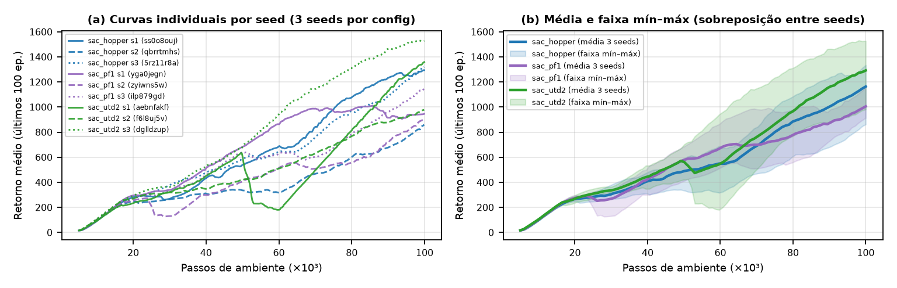
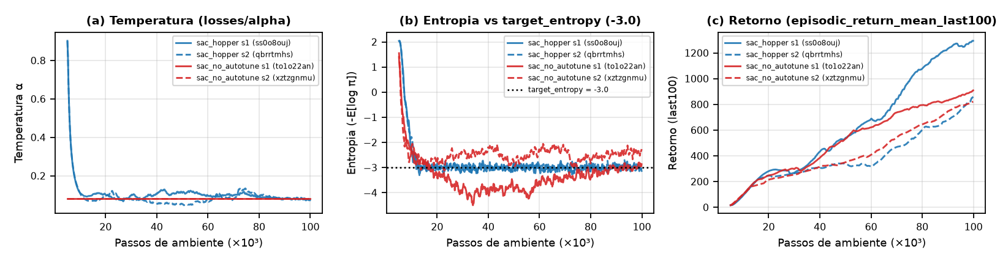
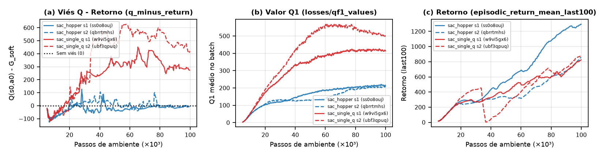
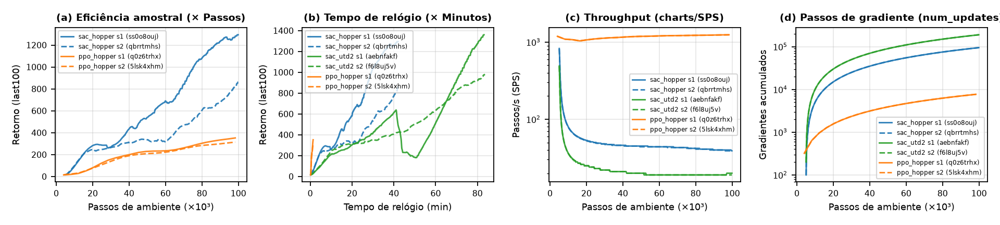

# Relatório Experimental: Soft Actor-Critic (SAC)

- **Aluno:** Pedro Reis
- **Ambiente Principal:** `Hopper-v5` (MuJoCo) — orçamento de $100.000$ passos de ambiente (`total_timesteps=100000`)
- **Repositório (Fork):** [https://github.com/Pedro-Reis2/t-zero-learning](https://github.com/Pedro-Reis2/t-zero-learning) (`algorithms/sac.py` e configs utilizados)
- **Projeto no Weights & Biases:** [https://wandb.ai/pedroreis2-federal-university-of-goi-s/sac-assignment](https://wandb.ai/pedroreis2-federal-university-of-goi-s/sac-assignment)

---

## Verificação Inicial (Partes 1 e 2)

As funções `squashed_gaussian_sample` (`algorithms/sac.py`, linhas 145–155) e `compute_soft_q_target` (`algorithms/sac.py`, linhas 179–180) foram implementadas e passaram nos 16 testes unitários (`pytest tests/test_sac.py`). No teste de sanidade em `Pendulum-v1` (`sac_pendulum`, run `zexmnmhh`, $20.000$ passos), o agente atingiu `eval/mean_return = -165.5 ± 51.6` e `eval/mean_return_sampled = -150.3 ± 72.5`, superando o critério `> -200`.

---

## Parte 3: Eficiência Amostral no `Hopper-v5` (100 mil passos)

Partindo do config de referência `configs/sac_hopper.yml` (`sac_hopper`), avaliamos 4 configurações candidatas, todas com **3 seeds (`seed=1, 2, 3`)** e orçamento exato de $100.000$ passos de ambiente.

### 1. Tabela de Candidatos e Resultados (3 seeds por configuração)

| Configuração (Runs no W&B) | Mudança (`antigo -> novo`) | Motivo observado (citando o run de origem) | `eval/mean_return` média (mín–máx) | `r_last100` final média (mín–máx) | Veredito |
| :--- | :--- | :--- | :---: | :---: | :---: |
| **`sac_hopper`** (Inicial / Final) `ss0o8ouj`, `qbrrtmhs`, `5rz11r8a` | Config padrão CleanRL (`ls=5000`, `tau=0.005`, `pf=2`, `utd=1`) | Configuração de referência; alta variância na avaliação final entre seeds (`20.2` no s3 vs `2462.5` no s2). | **1546.8** (20.2–2462.5) | **1163.7** (862.2–1334.8) | **Referência (Config Final)** |
| **`sac_ls1000`** `vfc8ax8e`, `f2vi8mh6`, `jy4eaw0u` | `sac.learning_starts`: `5000 -> 1000` | No run `ss0o8ouj` (`sac_hopper` s1), o agente passou os primeiros 5 mil passos (5% do orçamento) em coleta aleatória com `r_last100` estagnado em ~18, motivando iniciar os gradientes em 1.000 passos. | **947.9** (733.9–1374.3) | **775.5** (725.3–805.1) | **Piora** (intervalo de `r_last100` todo abaixo de 862.2) |
| **`sac_tau001`** `11gntid3`, `1z94x8bs`, `tux9q718` | `sac.tau`: `0.005 -> 0.01` | No run `qbrrtmhs` (`sac_hopper` s2), `losses/qf1_values` levou ~60k passos para subir até ~170 enquanto o retorno estagnou em ~330 entre 30k–60k passos, motivando dobrar a taxa Polyak das redes-alvo. | **862.1** (709.2–944.4) | **818.7** (536.1–1110.1) | **Indistinguível do ruído / Piora** (médias menores) |
| **`sac_pf1`** `yga0jegn`, `zyiwns5w`, `ilp879gd` | `sac.policy_frequency`: `2 -> 1` | No run `ss0o8ouj` (`sac_hopper` s1), atualizar o ator apenas a cada 2 passos do crítico atrasou a queda de `losses/actor_loss` até ~50k passos, motivando atualizar o ator em todo passo (`pf=1`). | **2124.9** (985.3–2988.3) | **1005.7** (913.9–1157.1) | **Indistinguível do ruído** (intervalos sobrepostos) |
| **`sac_utd2`** `aebnfakf`, `f6l8uj5v`, `dglldzup` | `sac.updates_per_step`: `1 -> 2` | Nos runs `ss0o8ouj` e `qbrrtmhs`, `r_last100` ainda subia quase linearmente aos 100k passos sem atingir platô com 94.900 gradientes, motivando dobrar para 2 atualizações por passo (`189.800` gradientes). | **1200.2** (1166.3–1257.5) | **1292.2** (981.6–1528.1) | **Indistinguível do ruído** (intervalos sobrepostos) |

**Conclusão da Parte 3 e escolha do Config Final:** Reduzir `learning_starts` para 1.000 (`sac_ls1000`) piorou o desempenho porque 98.900 atualizações sobre um buffer inicialmente muito pequeno causaram sobreajuste precoce. Acelerar `tau=0.01` (`sac_tau001`) desestabilizou os alvos $Q$ (`charts/q_minus_return` médio subiu de `-16.9` para `+6.5`). Já `sac_pf1` obteve a maior média em `eval/mean_return` (`2124.9`), mas média menor em `r_last100` (`1005.7`, com faixa `913.9–1157.1` totalmente contida na faixa `862.2–1334.8` do `sac_hopper`), enquanto `sac_utd2` obteve a maior média em `r_last100` (`1292.2`), mas menor média em `eval/mean_return` (`1200.2`) e ampla sobreposição de intervalos. Como nenhum candidato superou a variação entre seeds nas duas métricas, pela regra da atividade **o config final é o próprio config inicial (`sac_hopper`)**.

### 2. Figura: Curvas de Retorno do Config Inicial/Final (`sac_hopper`) e Candidatos Mais Próximos (`sac_pf1` e `sac_utd2`)

---

## Parte 4: O que cada peça faz (Ablações em `Hopper-v5`, 2 seeds cada)

Partindo do config final da Parte 3 (`sac_hopper`), executamos duas ablações com 2 seeds (`seed=1, 2`) cada.

### Ablação 1: Sem ajuste automático da temperatura (`sac.autotune=false`, `sac.alpha=0.08`)

- **Escolha e justificativa de `sac.alpha=0.08`:** Nos 3 seeds do `sac_hopper` (`ss0o8ouj`, `qbrrtmhs`, `5rz11r8a`), a curva `losses/alpha` inicia em $\exp(0) = 1{,}0$, cai rapidamente para $\sim 0{,}10$ aos 15 mil passos à medida que a entropia atinge o alvo, e permanece entre $0{,}06$ e $0{,}11$ no restante do treino, terminando em `0.0728`, `0.0805` e `0.0750` (média `0.0761`). Escolhemos portanto `sac.alpha=0.08` como valor fixo representativo do regime estacionário.
- **Previsão (antes de rodar):** Esperávamos que, mesmo usando o $\alpha = 0{,}08$ assintótico, a ausência de $\alpha$ elevado nos primeiros 15k passos e a falta de realimentação para corrigir desvios fariam `losses/entropy` desviar de `charts/target_entropy = -3.0`, reduzindo a estabilidade e o retorno final.
- **O que aconteceu (verificação):** A previsão **se confirmou**. Na Figura abaixo (`to1o22an` e `xztzgnmu`), enquanto o `sac_hopper` (`autotune=true`) ajusta `losses/alpha` dinamicamente (painel a) para travar `losses/entropy` exatamente sobre `target_entropy = -3.0` dos 15k aos 100k passos (painel b), com $\alpha=0{,}08$ fixo a entropia fica descontrolada: no seed 1 (`to1o22an`) cai abaixo de $-4{,}3$ entre 30k–60k passos (política prematuramente determinística, `eval/mean_return = 317.0`), e no seed 2 (`xztzgnmu`) permanece acima do alvo em $\sim -2{,}1$ (`eval/mean_return = 1087.7`). A média de `eval/mean_return` caiu de `2310.2` (seeds 1–2 do `sac_hopper`) para `702.4` (e `r_last100` caiu de `1078.2` para `867.0`).
- **Linha de `algorithms/sac.py` que explica o efeito:** Na **linha 341** (`self.alpha = self.log_alpha.exp().item() if cfg.autotune else float(cfg.alpha)`), `autotune=False` congela `self.alpha = 0.08`, e o condicional `if cfg.autotune:` nas **linhas 489–497** de `_update()` deixa de minimizar `compute_alpha_loss` (**linhas 198–206**: `return (-log_alpha.exp() * (log_pi.detach() + target_entropy)).mean()`), eliminando o mecanismo que eleva $\alpha$ quando $-\overline{\log\pi} < -3{,}0$ e reduz $\alpha$ quando $-\overline{\log\pi} > -3{,}0$.

### Ablação 2: Um crítico só (`sac.clipped_double_q=false`)

- **Previsão (antes de rodar):** Esperávamos que substituir $\min(Q_1, Q_2)$ por $Q_1$ isolado introduzisse forte viés positivo de superestimação (`charts/q_minus_return > 0` e `losses/qf1_values` inflados), degradando o retorno porque o ator passa a explorar picos espúrios da superfície de $Q_1$.
- **O que aconteceu (verificação):** A previsão **se confirmou claramente**. Na Figura abaixo (`w9vi5gx6` e `ubf3qpuq`), enquanto no `sac_hopper` (`clipped_double_q=true`) `charts/q_minus_return` permanece levemente negativo (média `-27.6` em `ss0o8ouj` e `-6.9` em `qbrrtmhs`, painel a) e `losses/qf1_values` converge para `~216` (painel b), com um único crítico (`sac_single_q`) o viés `charts/q_minus_return` explode para **`+300` a `+620`** (média `+171.1` e final `+251.3` em `w9vi5gx6`; média `+291.2` e final `+442.2` em `ubf3qpuq`) e `losses/qf1_values` mais que dobra, chegando a `409.0` e `491.4`. No seed 2 (`ubf3qpuq`, painel c), quando a superestimação ultrapassa `+300` (~35k passos), a política colapsa de `450` para `10` de retorno e encerra a avaliação com `eval/mean_return = 48.6` (média `745.7` nos 2 seeds vs `2310.2` no baseline).
- **Linha de `algorithms/sac.py` que explica o efeito:** Na **linha 367** (`pick_q2 = (lambda q1, q2: q2) if cfg.clipped_double_q else (lambda q1, q2: q1)`), `clipped_double_q=False` faz `pick_q2` substituir o segundo crítico pelo próprio $Q_1$. Assim, tanto o alvo de Bellman na **linha 455** (`compute_soft_q_target`, **linha 179**: `torch.min(next_q1, next_q2)`) quanto a perda do ator na **linha 483** (`compute_actor_loss`, **linha 195**: `(alpha * log_pi - torch.min(q1_pi, q2_pi)).mean()`) avaliam $\min(Q_1, Q_1) = Q_1$. Como o ator escolhe ações $a$ que maximizam $Q_1(s,a)$ e o alvo de Bellman usa $Q_1'(s',a')$, qualquer erro positivo de $Q_1$ é amplificado e retroalimentado no próprio alvo.

---

## Parte 5: SAC vs PPO Contínuo no `Hopper-v5` (100 mil passos, 2 seeds)

Comparamos o `sac_hopper` (`ss0o8ouj`, `qbrrtmhs`) — além do `sac_utd2` (`aebnfakf`, `f6l8uj5v`) para analisar o efeito de `updates_per_step` — com o PPO contínuo (`ppo_hopper`, runs `q0z6trhx` e `5lsk4xhm`, rodados com `configs/ppo_pendulum.yml` e `--override env_id=Hopper-v5 total_timesteps=100000 ppo_continuous_action.gamma=0.99 track=true seed=1,2`).

- **Previsão (antes de rodar):** Esperávamos que, no orçamento fixo de 100k passos, o SAC alcançasse retorno muito maior por passo de ambiente devido ao reuso off-policy no replay buffer, mas que o PPO contínuo fosse ordens de grandeza mais rápido em tempo de relógio (`charts/SPS` muito superior e `charts/num_updates` muito menor), vencendo nos primeiros minutos de execução.
- **Eficiência amostral (`Retorno × global_step`, painel a):** A previsão **se confirmou**. Aos 100 mil passos, o PPO atinge `r_last100` de apenas `361.1` (`q0z6trhx`) e `320.7` (`5lsk4xhm`), com `eval/mean_return` médio de **`370.6`** (`410.3` e `331.0`). No mesmo orçamento de passos, os seeds 1 e 2 do `sac_hopper` atingem `r_last100` de `1294.2` e `862.2` (média `1078.2`) e `eval/mean_return` médio de **`2310.2`** (`2157.8` e `2462.5`) — um retorno de avaliação **$6{,}2\times$ superior**.
- **Tempo de relógio (`Retorno × _runtime`, `charts/SPS`, `charts/num_updates` e efeito de `updates_per_step`, painéis b–d):**
  - **Qual chega mais longe com o mesmo tempo?** Nos primeiros **1,4 minutos** (tempo total que o PPO leva para concluir os 100k passos), **o PPO chega mais longe**: atinge `340.9` de retorno (`eval = 370.6`), enquanto em 1,4 min o `sac_hopper` (`SPS = 39`) executou apenas ~3.300 passos e ainda está na fase de ações aleatórias (`learning_starts = 5000`, retorno ~18). Contudo, a partir de **~6 minutos** de relógio (~14k passos), o `sac_hopper` ultrapassa o retorno final do PPO e segue crescendo até 42,1 minutos.
  - **Explicação com `charts/SPS` e `charts/num_updates`:** O PPO coleta rollouts vetorizados (`num_envs=4`, `num_steps=1024`, `batch_size=4096`) em 24 iterações e realiza apenas $24 \times 10 \times 32 = \mathbf{7.680}$ passos de gradiente (`charts/num_updates = 7680`), mantendo **`charts/SPS = 1246–1247`**. Já o `sac_hopper` (`updates_per_step=1`) executa 1 atualização dos críticos (`batch_size=256`) a cada passo de ambiente após `learning_starts=5000`, somando **94.999** atualizações dos críticos (`charts/num_updates = 94900` no log de 99.900) mais **47.499** atualizações de ator/$\alpha$, o que reduz o throughput em $32\times$ (**`SPS = 39–40`**, tempo médio **42,1 min**).
  - **Como `updates_per_step` da Parte 3 muda a resposta:** Dobrar `sac.updates_per_step` de `1` para `2` (`sac_utd2`, curvas verdes nos painéis b–d) dobra as atualizações para **189.998** (`charts/num_updates = 189800`), reduz `charts/SPS` exatamente à metade (**`19–20 SPS`**) e dobra o tempo de relógio para **83,3 min**, fazendo o SAC precisar de ~12 minutos (o dobro do `utd=1`) para alcançar o retorno que o PPO atinge em 1,4 min.
- **Mecanismo e estimativa do número médio de passos de gradiente por transição:**
  - **Peças do SAC responsáveis pela diferença:** (1) **Replay buffer off-policy** (`ReplayBuffer`, `algorithms/sac.py` linhas 212–243): retém todas as $100.000$ transições (`buffer_size = 10^6`) para reuso contínuo, enquanto o PPO descarta cada lote de 4.096 transições após a iteração; (2) **Ator reparametrizado + dois críticos $Q$** (`squashed_gaussian_sample`, linha 145, e `compute_actor_loss`, linha 195): guia a política diretamente pelo gradiente de primeira ordem $\nabla_\theta \min(Q_1, Q_2)(s, a_\theta(s))$ em vez do gradiente de razão de probabilidades do PPO; (3) **Máxima entropia com temperatura $\alpha$ automática** (linhas 179 e 206): sustenta exploração suave nas 3 dimensões de torque do Hopper sem colapso prematuro.
  - **Cálculo de quantas vezes, em média, cada transição entra em um passo de gradiente:**
    - **PPO:** Em cada uma das 24 iterações (`98.304` passos coletados), o lote de $4.096$ transições é embaralhado e dividido em 32 minibatches de 128 amostras ao longo de `update_epochs = 10` épocas (`algorithms/ppo_continuous_action.py`, linhas 286–290) antes de ser descartado. Portanto, cada transição processada entra em **exatamente $10$ passos de gradiente** (ou $98.304 \times 10 / 100.000 = \mathbf{9{,}83\text{ vezes}}$ sobre todas as 100k transições).
    - **SAC:** Com $T = 100.000$ passos, $L = 5.000$ (`learning_starts`), $B = 256$ (`batch_size`) e $u = \text{updates\_per\_step}$, ocorrem $(T - L)\cdot u = 95.000 \cdot u$ passos de gradiente dos críticos, cada um sorteando $B = 256$ transições do buffer. Na média global sobre as $T = 100.000$ transições coletadas, cada transição entra em:
      $$\bar{n}_{\text{SAC}} = \frac{(T - L)\cdot u \cdot B}{T} = \frac{95.000 \times 256 \times u}{100.000} = \mathbf{243{,}2 \cdot u\text{ passos de gradiente do crítico}}$$
      Isto é, **$243{,}2$ vezes** para `sac_hopper` (`u=1`, mais $243{,}2$ avaliações nos passos de ator/$\alpha$) e **$486{,}4$ vezes** para `sac_utd2` (`u=2`). Além disso, como no passo $t$ o buffer possui $t$ transições, uma transição coletada no início ($t \le 5.000$) é amostrada em média $\sum_{t=5001}^{100000} \frac{256 \cdot u}{t} \approx 256 \cdot u \ln(20) \approx \mathbf{766{,}9 \cdot u\text{ vezes}}$ — um reuso de dados **$24\times$ a $77\times$ maior** que no PPO, explicando a vantagem de eficiência amostral e o custo proporcional em tempo de relógio.

